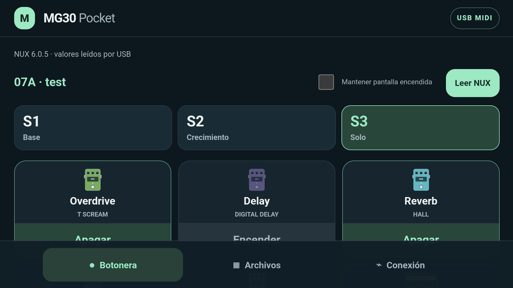

# MG30 Pocket

App Android gratuita y offline para NUX MG-30: botonera para tablet, edici?n live por USB MIDI y carga de ajustes de presets/bancos. Proyecto independiente, sin afiliaci?n con NUX.

**0.2.0 experimental: la integraci?n nueva se verific? con hardware simulado, no con una NUX f?sica.** Usa una copia del banco y prueba primero un slot prescindible. No se transfieren archivos IR/NAM: deben estar ya instalados en los mismos destinos. No equivale a restaurar un banco completo con sus recursos.

[Descargar APK de prueba](https://github.com/Isanfurg/mg30-pocket/releases/tag/v0.2.0) ? [Protocolo y l?mites](docs/PROTOCOL.md)



## Botonera para tocar con letras

- S1/S2/S3 grandes, con nombres personalizables por preset.
- Pedales llamados **Delay, Reverb, Overdrive, Modulaci?n, Compresor**, etc. Toca el nombre para ajustar; el bot?n inferior enciende/apaga conservando el modelo.
- Sliders live con relectura al soltar: diferencia entre enviado y confirmado.
- Preset anterior/siguiente y lectura del sonido actual sin importar un archivo primero.
- Mantener pantalla encendida opcional. Layout adaptable y Activity redimensionable para usar multiventana junto a tu app de letras. No requiere permiso de superposici?n.

## Conectar y controlar

Android 8+, WebView actualizado, tel?fono/tablet con USB host/OTG y MIDI de Android, cable **de datos** y NUX encendida. No requiere internet, micr?fono ni acceso global al almacenamiento.

1. En **Conexi?n**, elige dispositivo USB y puertos de env?o/recepci?n, y conecta.
2. En **Botonera ? Leer NUX**, identifica firmware y lee preset, escena y par?metros.
3. En **Control y conexi?n**, activa ?Mi NUX usa el mapeo MIDI predeterminado? solo si no reasignaste los CC en QuickTone. Se usa el canal configurado en Conexi?n; CC de escena configurado o 80 decimal por defecto.
4. Cambia escenas, enciende/apaga pedales o toca un pedal para editarlo. Los valores provienen del buffer de la NUX, no de un archivo local.
5. Los cambios live quedan sin guardar. **Guardar en NUX** prepara respaldo, revisi?n y escritura persistente con confirmaci?n.
6. Para letras: abre ambas apps en pantalla dividida usando el men? de aplicaciones recientes de Android. El procedimiento depende de la tablet. Mant?n MG30 Pocket visible durante transferencias.

Se filtra MG-30 cl?sica con firmware 5.0.2/6.0.2/6.0.5 y layout de 220 bytes validado; otros modelos/tama?os se rechazan. Es un filtro estructural: la prueba f?sica sigue pendiente. Los controles especiales/intercambiados y modelos desconocidos se conservan, sin inventar sliders. Si giras knobs f?sicos que no emiten MIDI, pulsa Leer NUX.

## Archivos y carga desde el celular

**Archivos** importa un `.mg30patch` individual o banco de 128 registros de 9902 bytes. Permite editar las tres escenas, modelos y par?metros mapeados, bypass, nombre, tempo, copiar escenas y exportar conservando el IR/NAM original. Un borrador separado conserva el documento y su original; no modifica autom?ticamente la NUX.

En **Botonera**, ?Cargar preset/banco del archivo? usa los slots escritos en el archivo. Antes de confirmar muestra destinos y guarda un respaldo de sus ajustes y del buffer activo. Relee para detectar cambios desde la revisi?n, escribe con ACK por parte, commit y comparaci?n posterior de los tres payloads. Un fallo no se anuncia como ?xito. Empezar por un preset de prueba.

**IR/NAM no se suben**: ni las muestras del archivo ni perfiles externos. Es obligatorio que esos recursos est?n instalados en los mismos slots. La carga reemplaza ajustes, ruteo y selecci?n de cabina/modelo, conservando los recursos presentes en la pedalera. No usar para mover presets con IR/NAM a destinos distintos sin instalar primero esos recursos.

?Respaldar los 128? exporta ajustes en `.mg30bank.json`; ?Abrir banco MIDI? prepara su restauraci?n al mismo firmware. ?Exportar ?ltimo respaldo previo? permite recuperar la copia autom?tica. Los respaldos no contienen muestras IR/NAM. Exportarlos antes de desinstalar.

La carga es secuencial, **no at?mica para todo el banco**. Si se desconecta, puede haber destinos ya cargados y otro incompleto. Se conserva la copia previa; no hay rollback autom?tico ni reintentos ciegos. Mant?n USB y la app visibles hasta finalizar.

## Compilar y probar

JDK 17, SDK 36/Build Tools y Node.js 22+. Gradle 8.13 con checksum y AGP 8.13.1 fijados. Sin dependencias npm ni Android de runtime externas.

```sh
npm test
./gradlew assembleDebug assembleDebugAndroidTest lintDebug --console plain
# Windows: .\gradlew.bat ...
```

APK: `app/build/outputs/apk/debug/app-debug.apk`. GitHub Actions compila, ejecuta pruebas y lint, y publica el artifact debug. Es una firma de pruebas, sin garant?a de coincidencia con otros builds/CI; conserva exportaciones antes de desinstalar para cambiar de firma.

```sh
# Emulador o instalaci?n de QA: usa fixtures sint?ticos y reemplaza su borrador/mapeo.
adb install -r app/build/outputs/apk/debug/app-debug.apk
adb install -r app/build/outputs/apk/androidTest/debug/app-debug-androidTest.apk
adb shell am instrument -w cl.isanfurg.mg30pocket.test/cl.isanfurg.mg30pocket.SmokeRunner
```

Validado: **23 pruebas Node**, compilaci?n/lint sin errores y smoke instrumentado en Android 16. Este ?ltimo verifica editor/borrador nativo y, con un peer simulado, lectura NUX, escenas, bypass, slider confirmado, ausencia de escritura antes de confirmar, respaldo, tres ACK, commit/relectura y vistas ancha/estrecha. La prueba del peer no abre USB f?sico.

Pendiente con hardware: tablet/cable/NUX, CC predeterminados de esa unidad, roundtrip real y selector de archivos. No usar esta versi?n sin probarla primero en ensayo y en un destino respaldado. El c?digo no incluye sonidos, IR ni perfiles privados.

Vista previa del editor en PC: `npm run preview`, http://127.0.0.1:8766 . USB MIDI y almacenamiento nativo funcionan en la APK.

## Fuentes y licencia

[NUX MG-30](https://nuxaudio.com/product/mg30/) ? [Android MIDI](https://developer.android.com/reference/android/media/midi/package-summary) ? [Protocolo comunitario](https://github.com/voronkovd/nux-mg30-mcp/blob/main/docs/PROTOCOL.md).

MIT. Cr?ditos de c?digo y fixture en [THIRD_PARTY_NOTICES.md](THIRD_PARTY_NOTICES.md). Dibujos de equipo gen?ricos y originales; marcas/modelos pertenecen a sus due?os.
