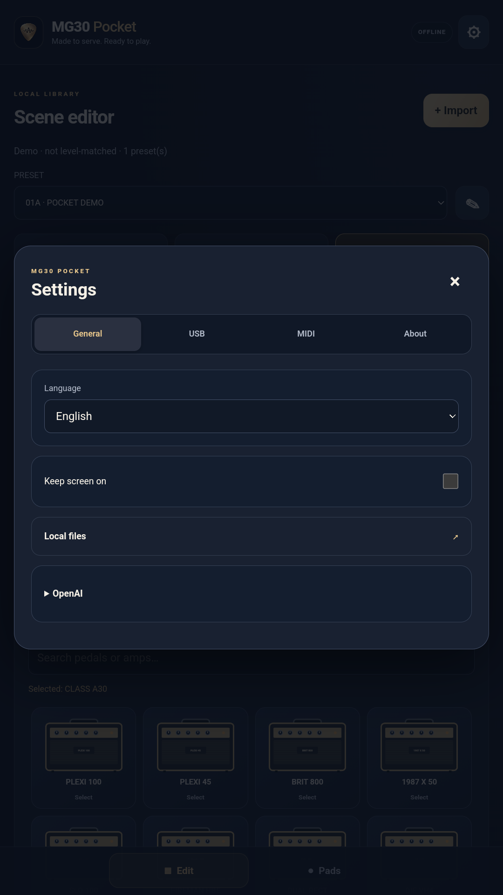
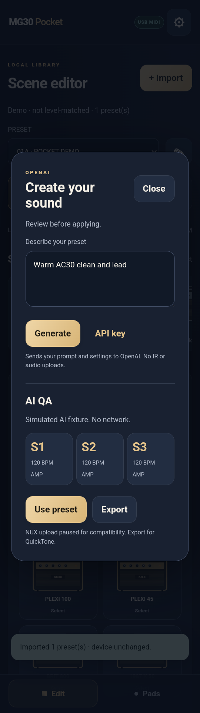

# MG30 Pocket


A free Android preset editor and MIDI controller for the NUX MG-30. Built for tablets, split-screen lyrics and live playing. Independent project, not affiliated with NUX.

[Download APK 0.5.0](https://github.com/Isanfurg/mg30-pocket/releases/tag/v0.5.0) | [Español](docs/README.es.md) | [MIT license](LICENSE)

## Play and edit

- **Edit:** read the current preset, switch scenes, toggle effects and adjust supported parameters. Illustrated model cards with search and confirmed readback.
- **Pads:** eight configurable buttons. Tap to play; hold to edit without sending MIDI.
- **Local files:** import/export QuickTone `.mg30patch` presets or full banks, copy scenes and recover drafts. Original IR/NAM payloads are preserved.
- **Settings:** separate General, USB, MIDI and About sections. English by default; Spanish available in General. Switching language preserves edits, custom names and MIDI connections.
- **Identity:** midnight blue, ivory and gold. A subtle Christian signature and a new pick icon. [Icon source prompt](docs/ICON-PROMPT.md).

Local editing and MIDI work offline. No ads or analytics. Android 8+, current WebView, USB host/OTG and a data cable required for MIDI.

## Connect

1. Settings > USB: select the device and ports, then Connect.
2. Enable Factory NUX mapping only if your CC assignments match the default NUX mapping.
3. Tap Read NUX. Reread after changing controls on the pedalboard.
4. Use Edit or Pads. Live edits are temporary.

Settings > MIDI holds the channel, scene CC and optional custom assignments. Each settings section is separate; advanced controls are collapsed.

## AI builder (optional)

1. Import a working preset as your template. The app demo is for UI previews, not hardware use.
2. Settings > General > OpenAI: paste your own [API key](https://platform.openai.com/api-keys) and save it.
3. Open AI builder, describe the sound and Generate.
4. Review all three scenes, then Use preset in the local editor or Export for QuickTone.

Uses the OpenAI Responses API with GPT-4.1 mini and structured JSON output. API usage is billed to your OpenAI account, separately from ChatGPT. The Generate button starts a paid API request; connecting USB or editing never does.

Your key is encrypted with Android Keystore (AES-GCM) in app-private preferences. It is never returned to JavaScript, added to drafts, included in exports or committed to this repository. Remove it in the same settings section. Requests go directly to `api.openai.com`, with redirects disabled and `store: false`. Only the prompt, preset settings and model catalog are sent; no IR/NAM payloads or audio are uploaded.

The result is untrusted input: model IDs, parameter names, integer ranges, scene count and duplicates are checked before a new local preset is accepted. Chain order, controllers and IR/NAM data remain from the template. A stale proposal cannot overwrite later edits. Suggestions are starting points, not measured loudness calibration.

 

References: [Responses API quickstart](https://developers.openai.com/api/docs/quickstart), [structured outputs](https://developers.openai.com/api/docs/guides/structured-outputs), [GPT-4.1 mini](https://developers.openai.com/api/docs/models/gpt-4.1-mini).

## Compatibility

**Direct NUX bank upload/save remains disabled.** A physical MG-30 reported a firmware compatibility warning during earlier PC testing. This release does not bypass that warning, update firmware or reset the device. Export generated presets for manual import through compatible QuickTone instead.

Read and temporary CC changes previously worked from a PC with firmware 6.0.5, but the reported warning remains unresolved. The APK still needs validation with a real tablet and pedalboard. IR/NAM assets are not transferred. Models with unknown or special controls remain protected.

## Development

Requirements: Java 17, Android SDK 36, build tools 36.0.0 and Node 22+.

```sh
npm test
./gradlew assembleDebug assembleDebugAndroidTest lintDebug
adb install -r app/build/outputs/apk/debug/app-debug.apk
adb install -r app/build/outputs/apk/androidTest/debug/app-debug-androidTest.apk
adb shell am instrument -w cl.isanfurg.mg30pocket.test/cl.isanfurg.mg30pocket.SmokeRunner
```

The Android smoke test uses a simulated MIDI/AI peer, makes no paid requests and opens no hardware ports. It checks drafts, language switching, separated settings, encrypted credential storage, model changes, pads, AI review/apply and narrow/wide layouts. The AI request has not been exercised against a paid account without a user key.

`npm run preview` opens the local web editor at `http://127.0.0.1:8766`; USB and secure key storage require the Android APK. No runtime third-party dependencies. Do not commit private presets, IR/NAM files or API keys. See [third-party notices](THIRD_PARTY_NOTICES.md).
