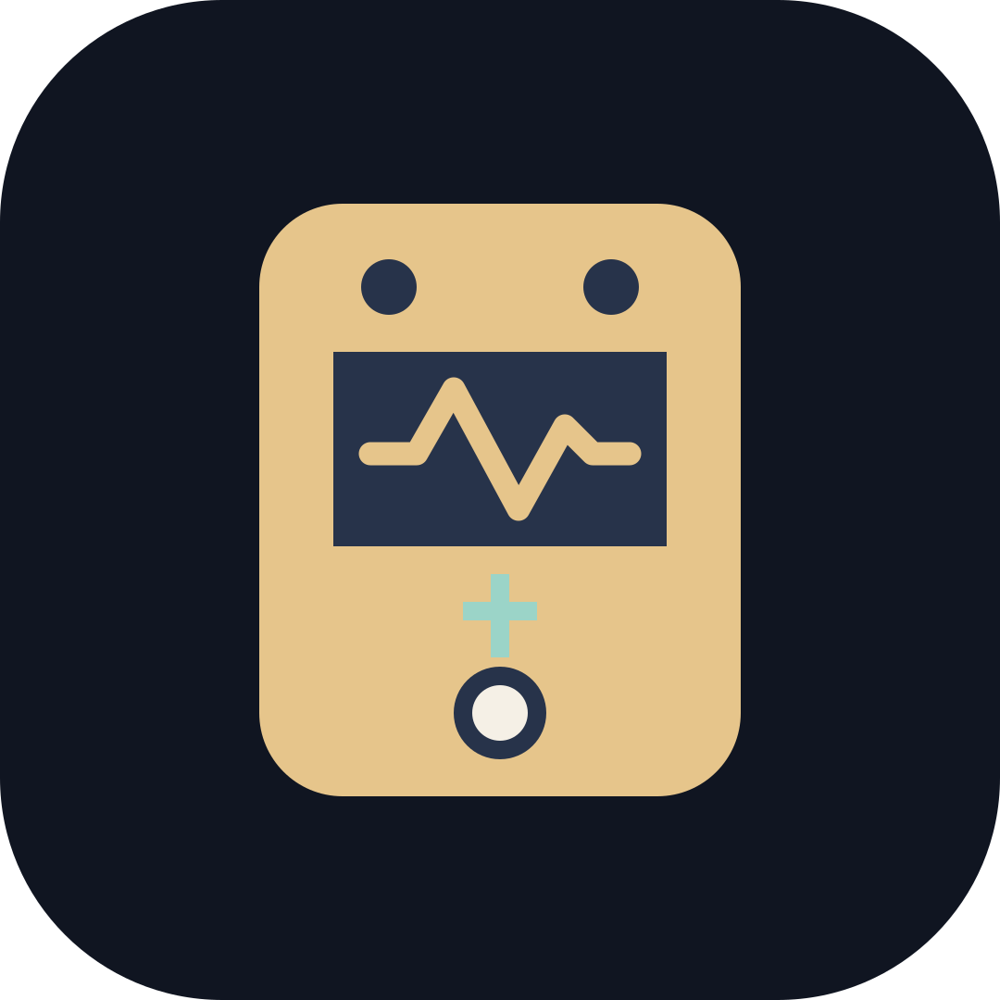
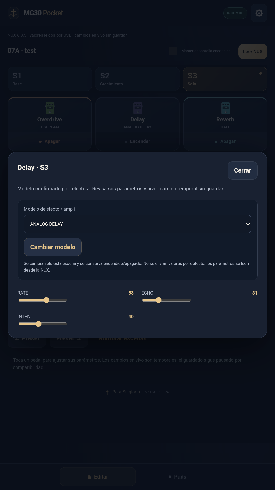
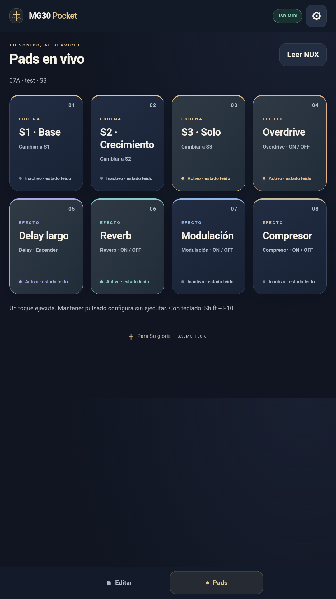

# MG30 Pocket



### Diseño 0.4.1

Azul noche, marfil y dorado suave; pedales y pads identificados por familia de efecto, estados con texto y luz, escenas grandes y controles táctiles. Una cruz pequeña en la marca y la firma «Para Su gloria · Salmo 150:6» acompañan la interfaz sin ocupar los controles. Todo funciona offline, sin fuentes ni imágenes remotas. Incluye icono Android y archivos PNG/SVG para la comunidad.

### Novedades 0.4.0

En **Editar**, toca un pedal, elige **Modelo de efecto / ampli** y pulsa **Cambiar modelo**. Permite cambiar overdrive, ampli, compresor, EQ, puerta, modulación, delay y reverb desde el catálogo de modelos normales. Conserva el bypass y modifica solo la escena actual; relee la NUX para confirmar el resultado y mostrar los parámetros del nuevo modelo. No envía parámetros por defecto: revisa los valores y el nivel después del cambio. IR/NAM y modelos especiales quedan fuera de este selector.

Icono original incluido en Android y como [PNG](docs/images/icon.png) y [SVG para compartir](docs/images/icon.svg), bajo la licencia MIT del proyecto. Los cambios de modelo siguen siendo temporales: el guardado de bancos continúa pausado mientras se investiga el aviso de firmware. No se ha validado este selector con hardware físico.



App Android gratuita y offline para controlar una NUX MG-30 desde una tablet, junto a tu app de letras. Proyecto independiente, sin afiliación con NUX.

[Descargar APK 0.4.1 de prueba](https://github.com/Isanfurg/mg30-pocket/releases/tag/v0.4.1)

## Dos pestañas

**Editar:** lee el preset actual, sus tres escenas y efectos. Toca un pedal para abrir sus parámetros y ajustar el sonido temporalmente por MIDI, con relectura al soltar el slider. Los modelos desconocidos y controles especiales se conservan, sin inventar controles.

**Pads:** ocho botones grandes y configurables. Un toque ejecuta; mantener pulsado unos 650 ms abre la configuración **sin ejecutar la acción**. Desplazar la pantalla o cancelar el gesto tampoco envía MIDI.

Cada pad puede tener nombre propio y acción:

- Encender/apagar, encender o apagar un efecto: Delay, Reverb, Overdrive, etc.
- Seleccionar S1, S2 o S3.
- Seleccionar un preset 01A–32D.
- Quedar sin asignar.

Las asignaciones se guardan en la tablet y pueden configurarse sin pedalera. Guardar un pad no envía MIDI. Se muestra estado activo/inactivo solo cuando hay una lectura de la NUX. Mantener pulsado, botón derecho o Shift+F10 abre la configuración; Enter/Espacio sirven para tocar o mantener con teclado. Seleccionar un preset puede descartar ajustes temporales sin guardar.

USB MIDI y archivos locales están en el botón **Ajustes**, sin ocupar otra pestaña. El editor de archivos mantiene importación/exportación `.mg30patch`, copia de escenas y borrador recuperable, conservando el recurso IR/NAM en el archivo.



## Estado de compatibilidad

**El aviso de firmware de la NUX física sigue sin resolver.** No se cambió ni actualizó su firmware. En 0.3:

- La escritura guardada y carga de bancos están bloqueadas tanto en UI como en el bridge Android.
- No se lanzan consultas propietarias automáticamente al conectar, volver de otra app o recibir cambios MIDI. Leer NUX y acciones live requieren una acción del usuario.
- IR/NAM no se transfieren. No hay actualización de firmware, reset ni consola SysEx genérica.
- Lectura y CC temporales funcionaron por USB desde PC en una MG-30 6.0.5: mezcla del delay, bypass conservando modelo y escena. El buffer se restauró exactamente. El usuario informó además de un aviso de compatibilidad durante esas pruebas; no se considera resuelta la integración por haber recibido datos.
- Falta probar la APK con tablet/cable/NUX físicos e identificar el mensaje completo. Si aparece el aviso, detener las pruebas y conservar el texto/foto para diagnosticarlo.

La UI y el protocolo se prueban en emulador con un peer simulado. Es una APK experimental para ensayo, no una garantía de funcionamiento en directo.

## Conectar

Android 8+, WebView actualizado, USB host/OTG, cable de datos y MG-30 encendida. No requiere internet, micrófono ni acceso global a los archivos.

1. Abre Ajustes, selecciona dispositivo USB y puertos de envío/recepción.
2. Pulsa Leer NUX manualmente para identificar y leer el estado.
3. En Ajustes → Control y conexión, confirma el mapeo predeterminado solo si no reasignaste los CC en QuickTone. El canal y CC de escena son configurables.
4. Usa Editar o Pads. Los ajustes del sonido son temporales; el guardado está pausado.

Para letras, usa pantalla dividida desde las aplicaciones recientes de Android. El método depende de la tablet. La Activity es redimensionable y la UI se adapta; no solicita superposición sobre otras apps. Mantener pantalla encendida es opcional. Girar algunos knobs físicos no emite MIDI: pulsa Leer NUX para actualizar.

## Compilar y probar

JDK 17, SDK/Build Tools 36, Node.js 22+. Gradle 8.13 y AGP 8.13.1 fijados. Sin dependencias npm ni Android de runtime externas.

```sh
npm test
./gradlew assembleDebug assembleDebugAndroidTest lintDebug --console plain
# Windows: .\gradlew.bat ...
```

APK: `app/build/outputs/apk/debug/app-debug.apk`. GitHub Actions ejecuta pruebas, compilación y lint y adjunta una APK debug. La firma local se mantiene entre releases locales; otros builds pueden tener otra firma. Exporta tus archivos antes de desinstalar para cambiar de firma.

```sh
# Solo en instalación de QA: reemplaza borrador y mapeo con fixtures sintéticos.
adb install -r app/build/outputs/apk/debug/app-debug.apk
adb install -r app/build/outputs/apk/androidTest/debug/app-debug-androidTest.apk
adb shell am instrument -w cl.isanfurg.mg30pocket.test/cl.isanfurg.mg30pocket.SmokeRunner
```

Pruebas Node: formato y preservación de recursos, MIDI fragmentado, protocolo de transferencia retenido pero bloqueado en producción, gesto de tap/hold/cancel y validación de pads. El smoke Android verifica lectura/control con peer simulado, persistencia del pad, hold sin MIDI, tap exactamente una vez, scroll sin acción y bloqueo de escrituras. No abre USB físico.

Preview PC: `npm run preview`, http://127.0.0.1:8766 . El bridge USB MIDI solo está en la APK.

## Créditos

MIT. [Créditos y licencia del fixture](THIRD_PARTY_NOTICES.md) · [Detalles de protocolo y funciones pausadas](docs/PROTOCOL.md). Dibujos de equipo genéricos y originales; marcas/modelos pertenecen a sus dueños. No se incluyen bancos personales, IR, NAM ni audio privados.
